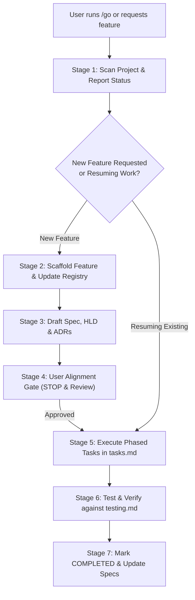

# Spec-Driven & ADR-First Development Workflow (`go`)

This skill provides a standardized, reusable workflow for engineering software features with rigorous architectural integrity. It guarantees that **every new feature starts with specifications and Architecture Decision Records (ADRs)** before any code is written, tracked through structured feature folders, actionable task checklists, and testing verification matrices.

---

## 1. Core Principles

1. **ADR-First Rule:** No implementation code or significant architectural modification begins without an explicit, documented Architecture Decision Record (ADR) reviewed by the user.
2. **Main Spec as Single Source of Truth:** The project root maintains `specs/main-spec.md` documenting overarching system design, tech stack boundaries, global conventions, and the master feature registry.
3. **Four Artifacts per Feature:** Every feature lives in `features/<FEATURE_ID>/` and contains exactly four documents:
   - `spec.md`: Requirements, user stories, functional/non-functional scope, API contracts.
   - `design.md`: High-Level Design (HLD), Sequence diagrams, and Architecture Decision Records (ADRs).
   - `tasks.md`: Phased execution checklist, current status, immediate actions needed, and blocker log.
   - `testing.md`: Test strategy, automated test matrix, manual curl/cli test steps, and acceptance sign-off.
4. **Interactive Alignment Gate:** The agent must explicitly present the design and ADRs to the user for feedback and approval before proceeding to implementation.

---

## 2. Directory Layout Standard

```text
<project-root>/
├── specs/
│   └── main-spec.md                    # System architecture, global conventions & feature registry
└── features/
    ├── README.md                       # Status dashboard of all registered features
    └── <FEATURE_ID>/                   # e.g., FEAT-001-doc-ingestion
        ├── spec.md                     # Feature requirements, user stories & contracts
        ├── design.md                   # HLD diagrams & Architecture Decision Records (ADRs)
        ├── tasks.md                    # Phased task checklist, status & action items
        └── testing.md                  # Test cases, automated tests & acceptance criteria
```

---

## 3. The `/go` Command Protocol

Whenever the user says `/go`, asks to check project status, or requests a new feature, follow this exact 6-stage protocol:



### Stage 1: Project & State Inspection
1. Inspect if `specs/main-spec.md` exists. If not, scaffold it.
2. Scan the `features/` directory. For every feature, inspect `tasks.md` to extract:
   - Feature ID and Name
   - Current Status (`PROPOSED`, `DESIGN_READY`, `IN_PROGRESS`, `TESTING`, `COMPLETED`, `BLOCKED`)
   - Current Focus / Next Action Needed
3. Display a concise status table to the user.

### Stage 2: Feature Intake & Scaffolding
When a new feature is requested:
1. Assign the next sequential Feature ID: `FEAT-001-<short-name>`, `FEAT-002-<short-name>`, etc.
2. Create the directory: `features/<FEATURE_ID>/`.
3. Scaffold all 4 standard files (`spec.md`, `design.md`, `tasks.md`, `testing.md`) using the skill templates.
4. Register the new feature in:
   - `specs/main-spec.md` (under `## 4. Master Feature Registry`)
   - `features/README.md` (under `## Active & Registered Features`)

### Stage 3: Draft Feature Spec, HLD & ADRs
Before writing any application code, thoroughly document:
1. **In `spec.md`:** User stories, functional requirements (FR-01, FR-02...), out-of-scope boundaries, request/response payloads.
2. **In `design.md`:**
   - High-Level Architecture & Sequence Diagrams.
   - **Architecture Decision Records (ADRs):**
     - **Title & Status** (`PROPOSED`)
     - **Context & Problem Statement** (Why this choice matters)
     - **Options Considered** (Pros & Cons of at least 2 alternatives)
     - **Decision Outcome & Justification** (Why the chosen option was picked)
     - **Consequences & Trade-offs** (Benefits, risks, mitigations)
3. **In `tasks.md`:** Populate actionable tasks broken down by phase with validation commands.
4. **In `testing.md`:** Define test cases (TC-01, TC-02...) and manual verification steps.

### Stage 4: User Alignment Gate (STOP & Review)
> [!IMPORTANT]
> **Do not begin coding immediately after drafting the design.**
> Present an executive summary of the ADRs and design decisions to the user. Ask for their review, critique, or approval.

### Stage 5: Systematic Task Execution
Once the user approves:
1. Update feature status in `tasks.md` to `IN_PROGRESS`.
2. Work through the tasks phase by phase.
3. Keep `tasks.md` updated as tasks are completed (change `[ ]` to `[x]`).
4. Keep the **Current Focus / Next Action** header accurate after each step.

### Stage 6: Testing & Verification
1. Execute the automated and manual verification steps documented in `testing.md`.
2. Ensure acceptance criteria from `spec.md` are satisfied.
3. Record test outputs or evidence in `testing.md`.

### Stage 7: Feature Completion Sign-Off
1. Change feature status to `COMPLETED` in `tasks.md`.
2. Update the status in `features/README.md` and `specs/main-spec.md`.
3. Inform the user that the feature is verified and ready.

---

## 4. Helper CLI (`spec_tool.py`)

A Python helper script is bundled with this skill at [`scripts/spec_tool.py`](./scripts/spec_tool.py):

```bash
# Initialize master spec and features dashboard in current directory
python scripts/spec_tool.py init --name "My Project"

# Scaffold a new feature with all 4 templates and register it
python scripts/spec_tool.py new-feature FEAT-001 "User Authentication"

# Print dashboard of all features and their live statuses
python scripts/spec_tool.py status
```

---

## 5. Summary of Artifacts

| File | Purpose | Key Content |
| :--- | :--- | :--- |
| `specs/main-spec.md` | Master project specification | Tech stack, system architecture, global constraints, master feature table |
| `features/README.md` | Feature registry dashboard | List of all features, their live statuses, and links |
| `features/<ID>/spec.md` | Feature requirements | User stories, functional/NFR requirements, API schemas, edge cases |
| `features/<ID>/design.md`| Architecture & ADRs | Sequence diagrams, component design, **Architecture Decision Records (ADRs)** |
| `features/<ID>/tasks.md` | Execution tracker | Status, current focus/next action, phased task checklist, blockers |
| `features/<ID>/testing.md`| Verification plan | Test case matrix, CLI/curl test steps, acceptance criteria checklist |
