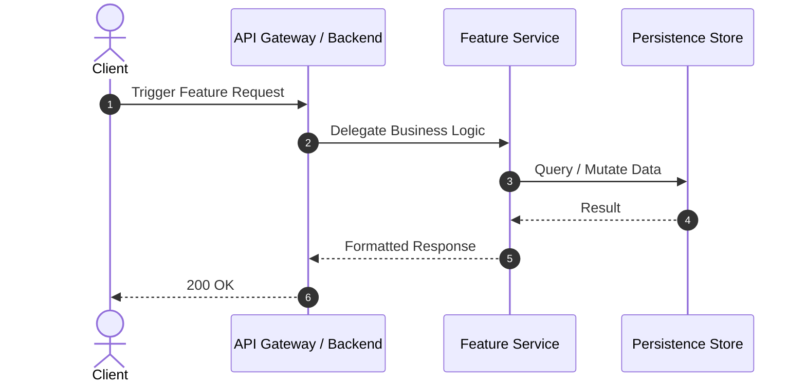

# Feature Design & ADRs: {{FEATURE_ID}} - {{FEATURE_NAME}}

> **Feature ID:** `{{FEATURE_ID}}`  
> **Status:** `PROPOSED` <!-- PROPOSED | REVIEWED | APPROVED | SUPERSEDED -->  
> **Created Date:** {{DATE}}  
> **Specification:** [Feature Spec](./spec.md) | [Tasks](./tasks.md) | [Testing](./testing.md)

---

## 1. High-Level Design (HLD)

### System Context & Component Interaction


### Key Architectural Flow
Detailed walkthrough of the runtime execution path, services involved, and state transitions.

---

## 2. Architecture Decision Records (ADRs)

> [!IMPORTANT]
> Every structural decision, technology selection, or significant trade-off for this feature MUST have an ADR documented here before implementation begins.

### ADR-01: {{TITLE_OF_DECISION_1}}

- **Status:** `PROPOSED` <!-- PROPOSED | ACCEPTED | REJECTED | SUPERSEDED -->
- **Deciders:** `<Engineering Team / Author>`
- **Date:** {{DATE}}

#### Context & Problem Statement
What is the specific challenge, requirement, or architectural question being solved? Why does a decision need to be made?

#### Options Considered
1. **Option A: `<Name>`**
   - *Pros:* ...
   - *Cons:* ...
2. **Option B: `<Name>`**
   - *Pros:* ...
   - *Cons:* ...
3. **Option C: `<Name>`**
   - *Pros:* ...
   - *Cons:* ...

#### Decision Outcome & Justification
**Chosen Option:** `Option A`  
**Rationale:** Why this option was chosen over the alternatives. What key trade-offs were accepted?

#### Consequences & Impact
- **Positive Consequences:** e.g., Faster retrieval time, reduced memory overhead.
- **Negative Consequences / Risks:** e.g., Additional dependency, operational overhead.
- **Mitigation Strategy:** How risks will be managed.

---

### ADR-02: {{TITLE_OF_DECISION_2}} *(Optional/Additional)*
*(Add more ADR blocks as necessary for data modeling, concurrency, protocol choices, or caching strategies)*

---

## 3. Data Model & Schema Changes
```sql
-- DDL or schema alterations required by this feature
```

---

## 4. Security & Error Handling Strategies
- **Authentication & Permissions:** Roles, tenant isolation, sensitive data masking.
- **Resilience:** Circuit breakers, retries, timeouts, and fallback behavior.
