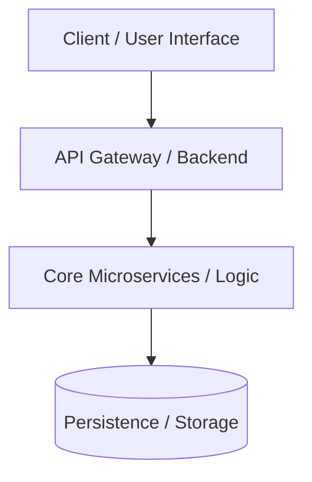

# Project Master Specification: {{PROJECT_NAME}}

> **Last Updated:** {{DATE}}  
> **Status:** Active / Living Document  
> **Repository Root:** `{{REPO_ROOT}}`

---

## 1. Executive Summary & Vision
- **Product Overview:** Concise description of what this project builds and the core problem it solves.
- **Target Audience:** Who uses this software (end users, internal teams, external APIs).
- **Core Value Proposition:** Primary outcomes, performance goals, or business impact.

---

## 2. High-Level System Architecture

### Component Boundaries & Tech Stack
| Subsystem | Technology Stack | Primary Responsibility |
| :--- | :--- | :--- |
| **Frontend / Client** | e.g. React / Next.js / Mobile | User interface & client-side rendering |
| **Backend / API** | e.g. Spring Boot / Node / Go | Business logic, authentication, routing |
| **Data & Storage** | e.g. PostgreSQL, Redis, S3 | Relational data, cache, object storage |
| **AI / Background** | e.g. Python / FastAPI / Workers | Asynchronous jobs, heavy processing |

---

## 3. Global Architectural Principles & Constraints
1. **Spec-First & ADR-First:** Every non-trivial feature must define its specification, design, and Architectural Decision Records (ADRs) before code execution.
2. **Modular Isolation:** Services maintain clear bounded contexts; cross-service communication uses documented API contracts.
3. **Traceable Testing:** Every task in a feature plan maps to a verification test case.
4. **Clean Code & Security:** Stateless authentication, parameterized database queries, and structured logging.

---

## 4. Master Feature Registry

All active, upcoming, and completed features are tracked in [`features/`](file:///features/):

| Feature ID | Feature Name | Owner / Lead | Status | Target Date | Spec Link |
| :--- | :--- | :--- | :--- | :--- | :--- |
| `FEAT-001` | Example Feature Name | Team | `PROPOSED` | YYYY-MM-DD | [FEAT-001](file:///features/FEAT-001/spec.md) |

*Status Legend:* `PROPOSED` ➔ `DESIGN_READY` ➔ `IN_PROGRESS` ➔ `TESTING` ➔ `COMPLETED` ➔ `DEPRECATED`

---

## 5. Global API & Data Conventions
- **API Standards:** RESTful JSON, ISO-8601 timestamps, standardized error envelopes.
- **Database Migrations:** Version-controlled DDL scripts.
- **Environment Variables:** All secrets loaded via environment or secret manager; `.env.example` committed.
