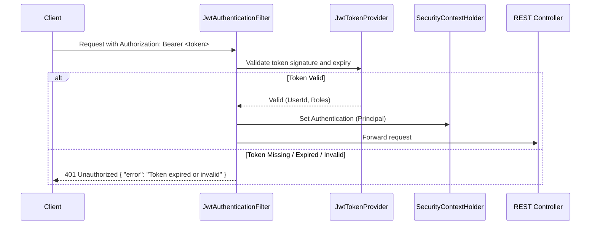

# Authentication & Distributed Rate Limiting Specification

This document details the security architecture, token lifecycles, and distributed Redis-backed rate limiting algorithms.

---

## 1. Authentication & Authorization (Spring Security + JWT)

### 1.1 Architecture
The system employs stateless JWT (JSON Web Token) authentication:
- Password hashing using `BCryptPasswordEncoder` (strength 12).
- Access tokens signed via `HMAC-SHA256` or `RSA-256`.
- Access token lifespan: 24 hours.
- Token claims:
  - `sub`: User UUID
  - `email`: User email
  - `role`: Role string (`ROLE_USER`, `ROLE_ADMIN`)
  - `iat`, `exp`: Issued at / expiration timestamps

### 1.2 Security Filter Flow


---

## 2. Distributed Rate Limiting (Redis Token Bucket)

To protect costly LLM calls, embedding generation, and server storage against abuse or DOS attacks, rate limiting is applied via Redis.

### 2.1 Rate Limits Tier Table

| Resource / Endpoint | Rate Limit | Scope Key | Algorithm |
| :--- | :--- | :--- | :--- |
| `POST /auth/*` | 10 requests / min | `rl:auth:<client_ip>` | Sliding Window Counter |
| `POST /documents/upload` | 10 uploads / hour | `rl:upload:<user_id>` | Token Bucket |
| `POST /chat/sessions/*/messages` | 30 queries / min | `rl:chat:<user_id>` | Token Bucket |
| Read Endpoints (`GET /*`) | 120 requests / min | `rl:read:<user_id>` | Sliding Window Counter |

### 2.2 Redis Token Bucket Lua Script

Atomic evaluation inside Redis avoids race conditions across multiple instances of Spring Boot:

```lua
-- KEYS[1]: Rate limit key (e.g. "rl:chat:user-uuid")
-- ARGV[1]: Bucket capacity (e.g. 30)
-- ARGV[2]: Refill rate per second (e.g. 0.5 = 30 tokens/60s)
-- ARGV[3]: Current epoch timestamp (seconds)
-- ARGV[4]: Requested tokens (default 1)

local key = KEYS[1]
local capacity = tonumber(ARGV[1])
local refill_rate = tonumber(ARGV[2])
local now = tonumber(ARGV[3])
local requested = tonumber(ARGV[4])

-- Get current bucket state
local data = redis.call("HMGET", key, "tokens", "last_updated")
local tokens = tonumber(data[1])
local last_updated = tonumber(data[2])

if tokens == nil then
    tokens = capacity
    last_updated = now
else
    local delta = math.max(0, now - last_updated)
    tokens = math.min(capacity, tokens + delta * refill_rate)
    last_updated = now
end

if tokens >= requested then
    tokens = tokens - requested
    redis.call("HMSET", key, "tokens", tokens, "last_updated", last_updated)
    redis.call("EXPIRE", key, math.ceil(capacity / refill_rate) * 2)
    return {1, tokens} -- Allowed: 1, Remaining tokens
else
    redis.call("HMSET", key, "tokens", tokens, "last_updated", last_updated)
    return {0, tokens} -- Rejected: 0
end
```

### 2.3 HTTP Rate Limit Headers
When rate limits are applied, responses include standard headers:
- `X-RateLimit-Limit`: Maximum tokens in window
- `X-RateLimit-Remaining`: Tokens currently remaining
- `Retry-After`: Seconds until quota replenishes (sent on `429 Too Many Requests`)
