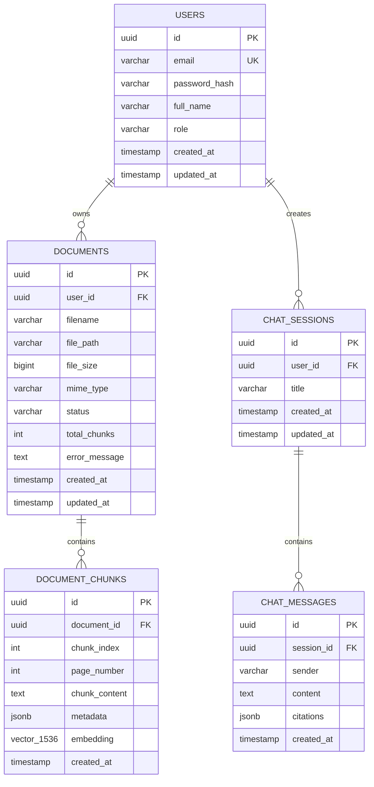

# Database Schema & pgvector Specification

This document details the PostgreSQL relational and vector schemas for the **AI Knowledge Assistant**, indexing strategies, query patterns, and migration policies.

---

## 1. Relational & Vector Entity Model (ERD)



---

## 2. DDL Specification

```sql
-- 1. Enable Vector Extension
CREATE EXTENSION IF NOT EXISTS "uuid-ossp";
CREATE EXTENSION IF NOT EXISTS vector;

-- 2. Users Table
CREATE TABLE IF NOT EXISTS users (
    id UUID PRIMARY KEY DEFAULT gen_random_uuid(),
    email VARCHAR(255) UNIQUE NOT NULL,
    password_hash VARCHAR(255) NOT NULL,
    full_name VARCHAR(255) NOT NULL,
    role VARCHAR(50) DEFAULT 'ROLE_USER' NOT NULL,
    created_at TIMESTAMP WITH TIME ZONE DEFAULT CURRENT_TIMESTAMP NOT NULL,
    updated_at TIMESTAMP WITH TIME ZONE DEFAULT CURRENT_TIMESTAMP NOT NULL
);

-- 3. Documents Table
CREATE TABLE IF NOT EXISTS documents (
    id UUID PRIMARY KEY DEFAULT gen_random_uuid(),
    user_id UUID NOT NULL REFERENCES users(id) ON DELETE CASCADE,
    filename VARCHAR(255) NOT NULL,
    file_path VARCHAR(500) NOT NULL,
    file_size BIGINT NOT NULL,
    mime_type VARCHAR(100) NOT NULL,
    status VARCHAR(50) DEFAULT 'PENDING' NOT NULL, -- PENDING, PROCESSING, INDEXED, FAILED
    total_chunks INT DEFAULT 0,
    error_message TEXT,
    created_at TIMESTAMP WITH TIME ZONE DEFAULT CURRENT_TIMESTAMP NOT NULL,
    updated_at TIMESTAMP WITH TIME ZONE DEFAULT CURRENT_TIMESTAMP NOT NULL
);

CREATE INDEX IF NOT EXISTS idx_documents_user_id ON documents(user_id);
CREATE INDEX IF NOT EXISTS idx_documents_status ON documents(status);

-- 4. Document Chunks & Vector Store Table
-- Vector dimension: 1536 for OpenAI text-embedding-3-small, or 768 for Gemini/SentenceTransformers
CREATE TABLE IF NOT EXISTS document_chunks (
    id UUID PRIMARY KEY DEFAULT gen_random_uuid(),
    document_id UUID NOT NULL REFERENCES documents(id) ON DELETE CASCADE,
    chunk_index INT NOT NULL,
    page_number INT,
    chunk_content TEXT NOT NULL,
    metadata JSONB DEFAULT '{}'::jsonb,
    embedding vector(1536),
    created_at TIMESTAMP WITH TIME ZONE DEFAULT CURRENT_TIMESTAMP NOT NULL
);

CREATE INDEX IF NOT EXISTS idx_chunks_document_id ON document_chunks(document_id);

-- HNSW Vector Cosine Distance Index
-- m: max number of connections per node (default 16)
-- ef_construction: size of the dynamic candidate list for constructing the graph (default 64)
CREATE INDEX IF NOT EXISTS idx_chunks_embedding_hnsw 
ON document_chunks 
USING hnsw (embedding vector_cosine_ops)
WITH (m = 16, ef_construction = 64);

-- 5. Chat Sessions Table
CREATE TABLE IF NOT EXISTS chat_sessions (
    id UUID PRIMARY KEY DEFAULT gen_random_uuid(),
    user_id UUID NOT NULL REFERENCES users(id) ON DELETE CASCADE,
    title VARCHAR(255) NOT NULL DEFAULT 'New Conversation',
    created_at TIMESTAMP WITH TIME ZONE DEFAULT CURRENT_TIMESTAMP NOT NULL,
    updated_at TIMESTAMP WITH TIME ZONE DEFAULT CURRENT_TIMESTAMP NOT NULL
);

CREATE INDEX IF NOT EXISTS idx_chat_sessions_user_id ON chat_sessions(user_id);

-- 6. Chat Messages Table
CREATE TABLE IF NOT EXISTS chat_messages (
    id UUID PRIMARY KEY DEFAULT gen_random_uuid(),
    session_id UUID NOT NULL REFERENCES chat_sessions(id) ON DELETE CASCADE,
    sender VARCHAR(20) NOT NULL CHECK (sender IN ('USER', 'ASSISTANT', 'SYSTEM')),
    content TEXT NOT NULL,
    citations JSONB DEFAULT '[]'::jsonb,
    created_at TIMESTAMP WITH TIME ZONE DEFAULT CURRENT_TIMESTAMP NOT NULL
);

CREATE INDEX IF NOT EXISTS idx_chat_messages_session_id ON chat_messages(session_id);
```

---

## 3. High-Performance Retrieval Queries

### 3.1 Cosine Similarity Search
Retrieve the top $K$ most similar chunks for a given query vector:

```sql
SELECT 
    c.id AS chunk_id,
    c.document_id,
    d.filename AS document_title,
    c.page_number,
    c.chunk_content,
    c.metadata,
    1 - (c.embedding <=> $1::vector) AS similarity_score
FROM document_chunks c
JOIN documents d ON c.document_id = d.id
WHERE (c.document_id = ANY($2) OR $2 IS NULL) -- Optional document filtering
ORDER BY c.embedding <=> $1::vector
LIMIT $3;
```

> **Note on Distance Operators in pgvector:**
> - `<=>`: Cosine distance ($1 - \text{cosine similarity}$). Lower is closer.
> - `<->`: Euclidean (L2) distance.
> - `<#>`: Negative inner product (for normalized vectors).

---

## 4. Index Tuning Guidelines

1. **`hnsw.ef_search` (Query time precision):**
   ```sql
   SET hnsw.ef_search = 100; -- Increases recall at minimal latency cost (default 40)
   ```
2. **Maintenance:**
   - HNSW graphs build incrementally without requiring periodic rebuilding (unlike IVFFlat which degrades if centroids drift).
   - VACUUM and ANALYZE should run regularly on `document_chunks`.
