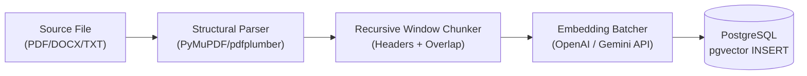

# RAG Pipeline & Grounded Citation Specification

This specification governs the parsing, chunking, embedding, vector retrieval, and prompt engineering required to produce hallucination-free answers with verifiable inline citations.

---

## 1. Document Ingestion Pipeline



### 1.1 Parsing Rules
1. **Per-Page Tracking:** Text must remain mapped to its source `page_number` (1-indexed).
2. **Structural Cleaning:**
   - Strip non-semantic headers/footers (page numbers, standard running headers).
   - Normalize whitespace while preserving markdown list structures and line breaks for code/tables.
3. **Table Extraction:**
   - Detect markdown/pipe tables or convert tabular blocks into formatted markdown tables so semantic relationships between columns and rows are not lost.

### 1.2 Chunking Strategy
- **Algorithm:** Recursive Character Chunking with structural hierarchy priority:
  1. Major Headings (`#`, `##`, `===`)
  2. Paragraph breaks (`\n\n`)
  3. Sentence breaks (`. `, `? `, `! `)
  4. Word boundaries (` `)
- **Target Size:** ~600 tokens (approx. 2400 characters).
- **Overlap:** ~100 tokens (approx. 400 characters) to prevent context fragmentation across boundaries.
- **Chunk Metadata:**
  ```json
  {
    "document_id": "a143b821-2e6b-4560-9ff9-0129bcfe3452",
    "filename": "Q3_Financial_Report.pdf",
    "page_number": 18,
    "chunk_index": 4,
    "section_title": "Operating Expenses by Department"
  }
  ```

---

## 2. Embedding Specification

- **Primary Model:** `text-embedding-3-small` (1536 dimensions) or Gemini `text-embedding-004` (768 dimensions).
- **Batching:** Send chunks in batches of 64 or 128 to minimize HTTP roundtrips.
- **Normalization:** Ensure embeddings are L2-normalized so that cosine distance is mathematically equivalent to dot product.

---

## 3. Retrieval & Grounding Rules

### 3.1 Retrieval
1. Embed the user query vector.
2. Query `document_chunks` using `ORDER BY embedding <=> query_vector LIMIT 5`.
3. Discard chunks below similarity threshold (e.g., similarity < 0.65).

### 3.2 System Prompt Template for LLM

```text
You are an expert Enterprise AI Knowledge Assistant.
Answer the user's question using ONLY the provided context chunks below.

GUIDELINES:
1. Grounding: If the answer cannot be determined strictly from the provided context, state:
   "I am sorry, but the provided documents do not contain enough information to answer this question."
   Do NOT attempt to extrapolate or bring in external knowledge.
2. Citations: Every single claim or statement of fact MUST be followed by an inline citation referencing the document and page number.
   Format: [Doc: <Filename>, p. <PageNumber>]
   Example: "Operating expenses in Q3 rose by 12% [Doc: Q3_Financial_Report.pdf, p. 18]."
3. Objectivity: Maintain an objective, professional tone.

CONTEXT CHUNKS:
---
[Chunk 1] Source: {filename_1} | Page: {page_1}
{chunk_content_1}
---
[Chunk 2] Source: {filename_2} | Page: {page_2}
{chunk_content_2}
---

CONVERSATION HISTORY:
{conversation_history}

USER QUESTION:
{query}
```

---

## 4. Citation Parsing & Verification

Before the response is finalized and returned:
1. The assistant extracts all bracketed tags `[Doc: ..., p. ...]` from the LLM completion.
2. Cross-references them with the actual retrieved chunk metadata to confirm validity.
3. Builds the structured `citations` array in the JSON response:
   ```json
   {
     "citationIndex": 1,
     "documentId": "a143b821-...",
     "documentTitle": "Q3_Financial_Report.pdf",
     "pageNumber": 18,
     "snippet": "...",
     "similarityScore": 0.892
   }
   ```
