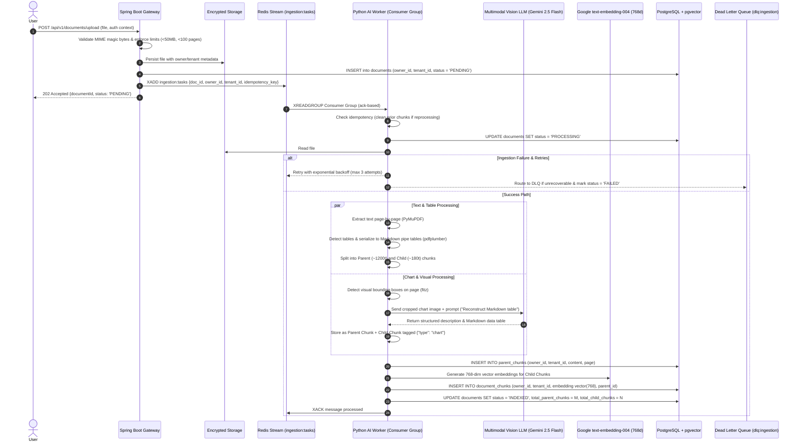

# Feature Design & ADRs: FEAT-001 - Document Ingestion Pipeline

> **Feature ID:** `FEAT-001`  
> **Status:** `DESIGN_READY`  
> **Parent Spec:** [FEAT-001 Spec](./spec.md) | [Tasks](./tasks.md) | [Testing](./testing.md)

---

## 1. High-Level Design (HLD)

### Multi-Modal Document Ingestion Flow with Durable Worker & Tenant Isolation


---

## 2. Architecture Decision Records (ADRs)

### ADR-01: Asynchronous Task Dispatch vs. Synchronous Ingestion
- **Status:** `ACCEPTED`
- **Deciders:** Engineering Team
- **Date:** 2026-09-14
- **Decision:** Asynchronous Ingestion with durable queue decoupling. Spring Boot returns immediate `202 Accepted` with a `documentId` and dispatches the task. The client queries `GET /api/v1/documents/{id}/status` to poll progress.

---

### ADR-02: PostgreSQL + pgvector with HNSW Index vs. Dedicated Vector DB
- **Status:** `ACCEPTED`
- **Deciders:** Engineering Team
- **Date:** 2026-09-14
- **Decision:** PostgreSQL with `pgvector` extension & HNSW indexing. Combines ACID relational metadata, tenant isolation filters, and vector search in a single database.

---

### ADR-03: Page-Preserving Recursive Text Chunking
- **Status:** `ACCEPTED`
- **Deciders:** Engineering Team
- **Date:** 2026-09-14
- **Decision:** Chunks retain physical PDF `page_number` tags. No cross-page merges without metadata tracking.

---

### ADR-04: Table Extraction via `pdfplumber` & Markdown Header Preservation
- **Status:** `ACCEPTED`
- **Deciders:** Engineering Team
- **Date:** 2026-09-15
- **Decision:** Detect tables via cell line intersection, serialize to Markdown pipe tables (`| Col1 | Col2 |`), keep tables <600 tokens atomic, and re-inject header rows into multi-page split chunks.

---

### ADR-05: Multimodal Vision Processing for PDF Charts & Diagrams
- **Status:** `ACCEPTED`
- **Deciders:** Engineering Team
- **Date:** 2026-09-15
- **Decision:** Crop chart visual bounding boxes, send to `gemini-2.5-flash` vision with structured prompt, store the reconstructed Markdown table and textual trends as chunks tagged with `{"type": "chart_description"}`.

---

### ADR-06: Unified Free-Tier Model Selection (Google AI Studio)
- **Status:** `ACCEPTED`
- **Deciders:** Engineering Team
- **Date:** 2026-09-15
- **Decision:** Unify all initial release capabilities exclusively on **Google AI Studio (Free Tier)**:
  - Embeddings: **Google `text-embedding-004` (768 dimensions)**
  - Generation: **Google `gemini-2.5-flash`**
  - Vision: **Google `gemini-2.5-flash`**

---

### ADR-07: Pluggable Strategy A (Structured Markdown) vs. Strategy B (ColPali Visual RAG)
- **Status:** `ACCEPTED`
- **Deciders:** Engineering Team
- **Date:** 2026-09-15
- **Decision:** Strategy A (CPU-friendly Parent-Document Markdown pipeline) is the default. Strategy B (GPU-based ColPali multi-vector late interaction) is pluggable via `INGESTION_STRATEGY=colpali`.

---

### ADR-08: Parent-Document (Small-to-Big) Chunking Architecture
- **Status:** `ACCEPTED`
- **Deciders:** Engineering Team
- **Date:** 2026-09-16
- **Decision:** 
  1. Parent Chunks (~1,000–1,500 tokens) stored in `parent_chunks` (raw text, no embeddings).
  2. Child Chunks (~150–200 tokens) stored in `document_chunks` with `embedding vector(768)` and foreign key `parent_chunk_id`.
  3. Single SQL retrieval expands child vectors to parent sections and deduplicates using `DISTINCT ON (parent_chunk_id)`.

---

### ADR-09: Multi-Tenant & Owner Authorization Scoping in PostgreSQL and pgvector
- **Status:** `ACCEPTED`
- **Deciders:** Engineering Team
- **Date:** 2026-09-17

#### Context & Problem Statement
Without explicit owner and tenant constraints in queries, any authenticated user could read, delete, or perform vector similarity queries against another tenant's documents (cross-tenant data leakage).

#### Decision Outcome & Justification
**Chosen:** Strict Owner & Tenant Scoping at the Database Layer:
1. `documents`, `parent_chunks`, and `document_chunks` all contain `owner_id UUID NOT NULL` and `tenant_id UUID NOT NULL`.
2. Every status, download, delete, and retrieval query strictly appends:
   `WHERE owner_id = :current_user_id AND tenant_id = :current_tenant_id`.
3. Vector searches enforce tenant filtering in the HNSW candidate phase:
   ```sql
   SELECT DISTINCT ON (p.id) ...
   FROM document_chunks c
   JOIN parent_chunks p ON c.parent_chunk_id = p.id
   WHERE c.tenant_id = :tenant_id AND c.owner_id = :owner_id
   ORDER BY p.id, (c.embedding <=> :query_vector::vector)
   LIMIT :top_k;
   ```
4. A composite B-tree index `(tenant_id, owner_id)` is created on `document_chunks` and `parent_chunks` to prevent full table scans before vector distance calculation.

---

### ADR-10: Resilient Asynchronous Ingestion (Redis Streams, Retries, DLQ & Idempotency)
- **Status:** `ACCEPTED`
- **Deciders:** Engineering Team
- **Date:** 2026-09-17

#### Context & Problem Statement
Document ingestion can fail due to transient network hiccups, external rate limits (15 RPM on Google AI Studio), or memory spikes. A simple in-memory queue risks data loss on crashes and lacks dead-letter routing.

#### Decision Outcome & Justification
**Chosen:** Redis Streams with Consumer Groups:
1. **Durable Queue:** Spring Boot writes to stream `ingestion:tasks` via `XADD`. Workers read using `XREADGROUP` with explicit acknowledgment (`XACK`).
2. **Idempotency:** Each task carries `idempotency_key = sha256(doc_id + file_content)`. If a re-ingestion job arrives, the worker deletes any existing chunks in `parent_chunks` and `document_chunks` for that `doc_id` inside a transaction before writing new ones.
3. **Retry with Exponential Backoff:** If a worker throws a transient error (e.g. rate limit), it retries with exponential backoff (e.g. 5s, 15s, 45s) up to 3 attempts.
4. **Dead-Letter Queue (DLQ):** After 3 failures, the task is routed to `dlq:ingestion`, and the document status in PostgreSQL is updated to `FAILED` with an actionable `error_message`.

---

### ADR-11: Document Ingestion Safety, Limits & Lifecycle Cleanup
- **Status:** `ACCEPTED`
- **Deciders:** Engineering Team
- **Date:** 2026-09-17

#### Context & Problem Statement
Malicious or malformed files can cause Denial of Service (DOS), zip bombs, memory exhaustion, or security breaches. Document deletion must cleanly purge all artifacts.

#### Decision Outcome & Justification
**Chosen:** Multi-layered Ingestion Safety:
1. **MIME Magic-Byte Sniffing:** Validate file headers via magic bytes (`application/pdf`, `application/vnd.openxmlformats...`, `text/plain`). Disguised executables or script files are rejected immediately with HTTP 400.
2. **Resource Boundaries:**
   - Max file size: **50 MB**
   - Max pages: **100 pages per document**
   - Max vision image resolution: **2048x2048px**
   - Timeouts: **30 seconds** per vision call, **5 minutes** total processing timeout per document.
3. **Definitive Storage Strategy:**
   - **Local Development:** Local volume mount `/shared/storage` configured with restricted permissions.
   - **Production:** S3/MinIO compatible object store with server-side encryption (AES-256) and presigned URLs.
4. **Lifecycle Cleanup:**
   - Calling `DELETE /api/v1/documents/{id}` verifies tenant ownership, triggers a database transaction that deletes the document record (which cascades `ON DELETE CASCADE` to delete all `parent_chunks` and `document_chunks`), and deletes the physical file from storage.

---

## 3. Schema Reference

```sql
-- 1. Documents Table with Owner & Tenant Scoping
CREATE TABLE IF NOT EXISTS documents (
    id UUID PRIMARY KEY DEFAULT gen_random_uuid(),
    user_id UUID NOT NULL REFERENCES users(id) ON DELETE CASCADE,
    tenant_id UUID NOT NULL,
    filename VARCHAR(255) NOT NULL,
    file_path VARCHAR(500) NOT NULL,
    file_size BIGINT NOT NULL,
    mime_type VARCHAR(100) NOT NULL,
    status VARCHAR(50) DEFAULT 'PENDING' NOT NULL, -- PENDING, PROCESSING, INDEXED, FAILED
    total_parent_chunks INT DEFAULT 0,
    total_child_chunks INT DEFAULT 0,
    error_message TEXT,
    created_at TIMESTAMP WITH TIME ZONE DEFAULT CURRENT_TIMESTAMP NOT NULL,
    updated_at TIMESTAMP WITH TIME ZONE DEFAULT CURRENT_TIMESTAMP NOT NULL
);

CREATE INDEX IF NOT EXISTS idx_documents_tenant_owner ON documents(tenant_id, user_id);
CREATE INDEX IF NOT EXISTS idx_documents_status ON documents(status);

-- 2. Parent Chunks Table
CREATE TABLE IF NOT EXISTS parent_chunks (
    id UUID PRIMARY KEY DEFAULT gen_random_uuid(),
    document_id UUID NOT NULL REFERENCES documents(id) ON DELETE CASCADE,
    user_id UUID NOT NULL REFERENCES users(id) ON DELETE CASCADE,
    tenant_id UUID NOT NULL,
    page_number INT NOT NULL,
    section_title VARCHAR(255),
    content TEXT NOT NULL,
    created_at TIMESTAMP WITH TIME ZONE DEFAULT CURRENT_TIMESTAMP NOT NULL
);

CREATE INDEX IF NOT EXISTS idx_parent_chunks_tenant_owner ON parent_chunks(tenant_id, user_id);
CREATE INDEX IF NOT EXISTS idx_parent_chunks_document_id ON parent_chunks(document_id);

-- 3. Child Chunks & Vector Store (768 Dimensions)
CREATE TABLE IF NOT EXISTS document_chunks (
    id UUID PRIMARY KEY DEFAULT gen_random_uuid(),
    parent_chunk_id UUID NOT NULL REFERENCES parent_chunks(id) ON DELETE CASCADE,
    document_id UUID NOT NULL REFERENCES documents(id) ON DELETE CASCADE,
    user_id UUID NOT NULL REFERENCES users(id) ON DELETE CASCADE,
    tenant_id UUID NOT NULL,
    chunk_index INT NOT NULL,
    page_number INT NOT NULL,
    chunk_content TEXT NOT NULL,
    metadata JSONB DEFAULT '{}'::jsonb,
    embedding vector(768), -- Strictly Google text-embedding-004
    created_at TIMESTAMP WITH TIME ZONE DEFAULT CURRENT_TIMESTAMP NOT NULL
);

CREATE INDEX IF NOT EXISTS idx_chunks_tenant_owner ON document_chunks(tenant_id, user_id);
CREATE INDEX IF NOT EXISTS idx_chunks_parent_id ON document_chunks(parent_chunk_id);
CREATE INDEX IF NOT EXISTS idx_chunks_document_id ON document_chunks(document_id);

-- HNSW Cosine Index
CREATE INDEX IF NOT EXISTS idx_chunks_embedding_hnsw 
ON document_chunks 
USING hnsw (embedding vector_cosine_ops)
WITH (m = 16, ef_construction = 64);
```
