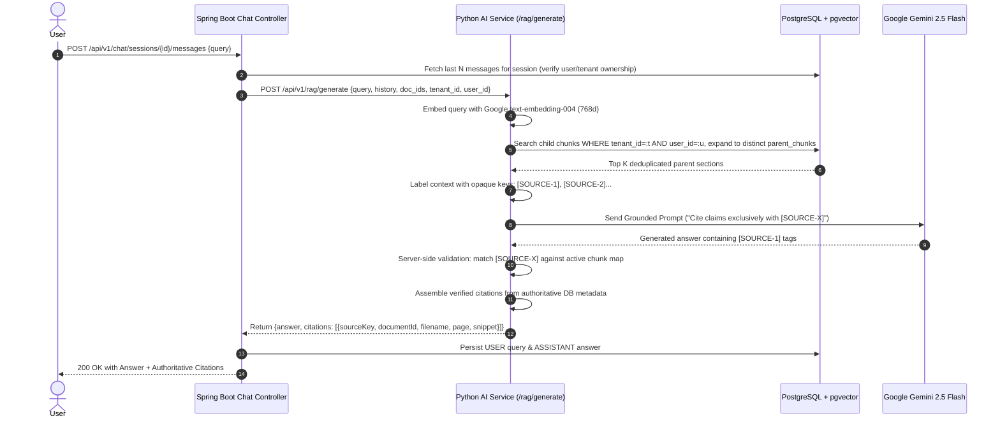

# Feature Design & ADRs: FEAT-002 - Grounded RAG Query & Citations

> **Feature ID:** `FEAT-002`  
> **Status:** `DESIGN_READY`  
> **Parent Spec:** [FEAT-002 Spec](./spec.md) | [Tasks](./tasks.md) | [Testing](./testing.md)

---

## 1. High-Level Design (HLD)



---

## 2. Architecture Decision Records (ADRs)

### ADR-01: Server-Assigned Opaque Citation Keys (`[SOURCE-X]`) & Server-Side Metadata Resolution
- **Status:** `ACCEPTED` (Revised)
- **Deciders:** Engineering Team
- **Date:** 2026-09-17

#### Context & Problem Statement
Asking the LLM to write out file names and page numbers (e.g. `[Doc: Q3_Report.pdf, p. 18]`) and validating with regex verifies only superficial formatting. It does not prove the model cited a real retrieved chunk and allows the model to hallucinate plausible-looking filenames and page numbers.

#### Options Considered
1. **Option A: Opaque Server-Assigned Keys (`[SOURCE-X]`) with Server-Side Metadata Resolution** (Selected)
2. **Option B: Regex parsing of free-form `[Doc: ..., p. ...]` tags**
3. **Option C: Pure JSON mode with required citation object schema**

#### Decision Outcome & Justification
**Chosen:** `Option A`  
1. In the RAG prompt, retrieved parent chunks are presented with server-assigned opaque tags:
   ```text
   [SOURCE-1] (Page: 14)
   {parent_content_1}
   ---
   [SOURCE-2] (Page: 18)
   {parent_content_2}
   ```
2. The LLM is instructed: *"Cite supporting facts exclusively using `[SOURCE-X]` tags. Do not invent source IDs."*
3. The server inspects the completion:
   - Identifies all `[SOURCE-X]` tags.
   - Asserts that $X$ exists in the active retrieved set. Any non-existent source tag (e.g. `[SOURCE-99]`) is stripped.
   - Resolves the citation from **authoritative server metadata** (retrieved document ID, actual file name, physical page number, and matched snippet text).
4. The response returned to the client contains clean inline tags and a structured, verified `citations` array.

#### Consequences
- **Positive:** Zero vulnerability to hallucinated file names or page numbers; robust server-side citation integrity.
- **Negative:** Minor regex/token replacement step on the server before presenting final text.

---

### ADR-02: Cosine Distance Metric (`<=>`) with 768d Embeddings
- **Status:** `ACCEPTED`
- **Deciders:** Engineering Team
- **Date:** 2026-09-17
- **Decision:** Use cosine distance (`vector_cosine_ops`) with HNSW index against 768-dimensional child chunk vectors generated by Google `text-embedding-004`. Normalized cosine distance handles variable chunk lengths accurately.

---

### ADR-03: Zero-Hallucination Grounding Prompt Strategy
- **Status:** `ACCEPTED`
- **Deciders:** Engineering Team
- **Date:** 2026-09-14
- **Decision:** System prompt mandates: *"If the answer cannot be determined strictly from the provided context sources, reply: 'I am sorry, but the uploaded documents do not contain sufficient information to answer this question.' Do not use pre-training knowledge."* Temperature is set to `0.1`.

---

### ADR-04: Tenant and Owner Authorization in Vector Search
- **Status:** `ACCEPTED`
- **Deciders:** Engineering Team
- **Date:** 2026-09-17

#### Context & Problem Statement
Vector similarity search must never retrieve context chunks belonging to other users or organizations.

#### Decision Outcome & Justification
**Chosen:** Mandatory tenant and owner filtering inside the vector retrieval SQL query:
```sql
SELECT DISTINCT ON (p.id)
    p.id AS parent_id,
    c.id AS matched_chunk_id,
    p.document_id,
    d.filename AS document_title,
    p.page_number,
    p.content AS chunk_content,
    c.chunk_content AS matched_snippet,
    1 - (c.embedding <=> :vector::vector) AS similarity_score
FROM document_chunks c
JOIN parent_chunks p ON c.parent_chunk_id = p.id
JOIN documents d ON p.document_id = d.id
WHERE c.tenant_id = :tenant_id 
  AND c.user_id = :user_id
  AND (c.document_id = ANY(:doc_ids) OR :doc_ids IS NULL)
ORDER BY p.id, (c.embedding <=> :vector::vector)
LIMIT :limit;
```
This guarantees zero vector leakage across tenants.

---

## 3. Schema & Context Mapping
Server metadata resolver constructs the output citation:
```json
{
  "sourceKey": "[SOURCE-1]",
  "documentId": "a143b821-2e6b-4560-9ff9-0129bcfe3452",
  "documentTitle": "Annual_Report.pdf",
  "pageNumber": 18,
  "snippet": "Operating expenses breakdown: R&D expenses reached $14.2M...",
  "similarityScore": 0.895
}
```
