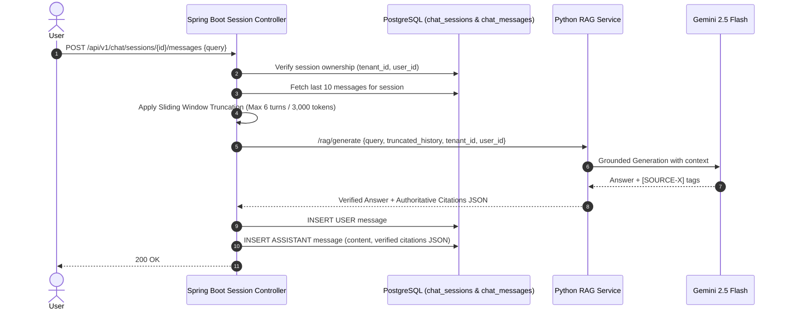

# Feature Design & ADRs: FEAT-004 - Chat Sessions & Conversation History

> **Feature ID:** `FEAT-004`  
> **Status:** `DESIGN_READY`  
> **Parent Spec:** [FEAT-004 Spec](./spec.md) | [Tasks](./tasks.md) | [Testing](./testing.md)

---

## 1. High-Level Design (HLD)

### Multi-Turn Session Lifecycle & Context Truncation


---

## 2. Architecture Decision Records (ADRs)

### ADR-01: Strict Session Ownership and Tenant Scoping
- **Status:** `ACCEPTED`
- **Deciders:** Engineering Team
- **Date:** 2026-09-17

#### Context & Problem Statement
Conversation logs contain sensitive enterprise Q&A. Cross-session unauthorized access must be completely prevented.

#### Decision Outcome & Justification
**Chosen:** Both `chat_sessions` and `chat_messages` tables include `user_id UUID NOT NULL` and `tenant_id UUID NOT NULL`. All list, get, and delete operations filter strictly by `(tenant_id, user_id)`. Accessing another user's session returns `404 Not Found`.

---

### ADR-02: Sliding Window Context Truncation Strategy
- **Status:** `ACCEPTED`
- **Deciders:** Engineering Team
- **Date:** 2026-09-17

#### Context & Problem Statement
Unbounded conversation history would eventually exceed token budgets, increase latency, and waste context on stale topics.

#### Decision Outcome & Justification
**Chosen:** Hybrid Turn & Token Budget Sliding Window:
1. Fetch up to the **last 6 message turns** (3 user questions + 3 assistant answers).
2. Calculate total token count; if exceeding **3,000 tokens**, truncate from the oldest turn while preserving the immediate preceding turn.
3. System prompt and document context chunks take highest priority; conversational history is strictly secondary context for conversational pronouns and references.

---

### ADR-03: Message Schema & Citation Immutability
- **Status:** `ACCEPTED`
- **Deciders:** Engineering Team
- **Date:** 2026-09-17

#### Context & Problem Statement
If an underlying document is later updated or deleted, past answers must retain historical audit integrity of what was cited at the time the answer was given.

#### Decision Outcome & Justification
**Chosen:** Store authoritative citation metadata snapshot inside `chat_messages.citations` as JSONB at message creation time. The citation snapshot is immutable and preserved independently of subsequent document modifications.

---

### ADR-04: Retention & Cascading Deletion Policy
- **Status:** `ACCEPTED`
- **Deciders:** Engineering Team
- **Date:** 2026-09-17

#### Context & Problem Statement
Users need the ability to delete sessions, and enterprise data policies require periodic cleanup of stale conversation logs.

#### Decision Outcome & Justification
**Chosen:**
1. Foreign key constraint `ON DELETE CASCADE` from `chat_sessions` to `chat_messages`.
2. Deleting a session via `DELETE /api/v1/chat/sessions/{id}` instantly purges all associated messages.
3. Automated retention scheduled task purges sessions older than 90 days.

---

## 3. Database Schema

```sql
CREATE TABLE IF NOT EXISTS chat_sessions (
    id UUID PRIMARY KEY DEFAULT gen_random_uuid(),
    user_id UUID NOT NULL REFERENCES users(id) ON DELETE CASCADE,
    tenant_id UUID NOT NULL,
    title VARCHAR(255) NOT NULL DEFAULT 'New Conversation',
    created_at TIMESTAMP WITH TIME ZONE DEFAULT CURRENT_TIMESTAMP NOT NULL,
    updated_at TIMESTAMP WITH TIME ZONE DEFAULT CURRENT_TIMESTAMP NOT NULL
);

CREATE INDEX IF NOT EXISTS idx_chat_sessions_tenant_user ON chat_sessions(tenant_id, user_id);

CREATE TABLE IF NOT EXISTS chat_messages (
    id UUID PRIMARY KEY DEFAULT gen_random_uuid(),
    session_id UUID NOT NULL REFERENCES chat_sessions(id) ON DELETE CASCADE,
    user_id UUID NOT NULL REFERENCES users(id) ON DELETE CASCADE,
    tenant_id UUID NOT NULL,
    sender VARCHAR(20) NOT NULL CHECK (sender IN ('USER', 'ASSISTANT', 'SYSTEM')),
    content TEXT NOT NULL,
    citations JSONB DEFAULT '[]'::jsonb,
    created_at TIMESTAMP WITH TIME ZONE DEFAULT CURRENT_TIMESTAMP NOT NULL
);

CREATE INDEX IF NOT EXISTS idx_chat_messages_session_id ON chat_messages(session_id);
CREATE INDEX IF NOT EXISTS idx_chat_messages_tenant_user ON chat_messages(tenant_id, user_id);
```
