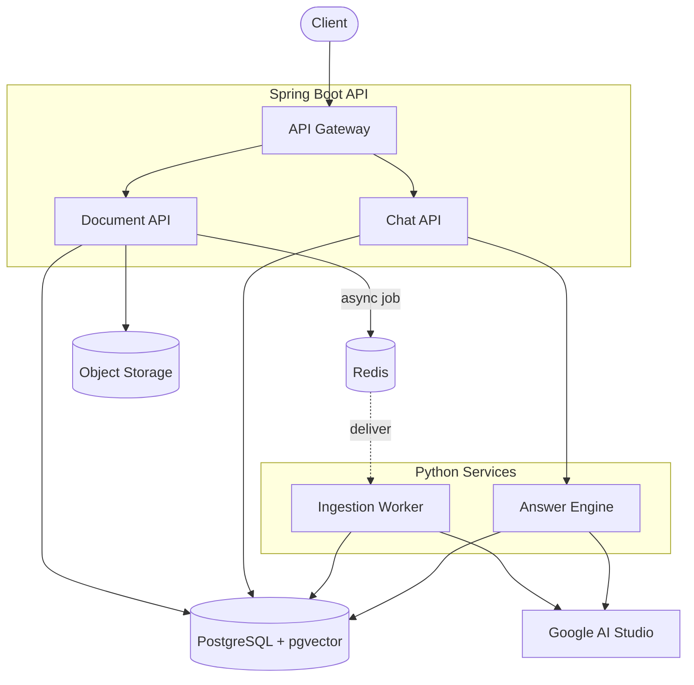
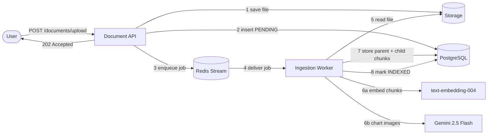
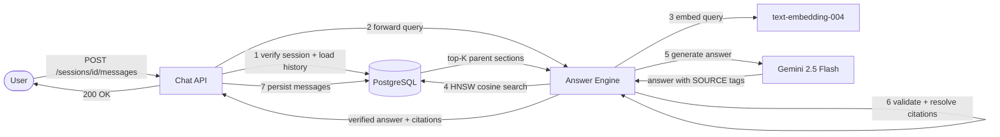
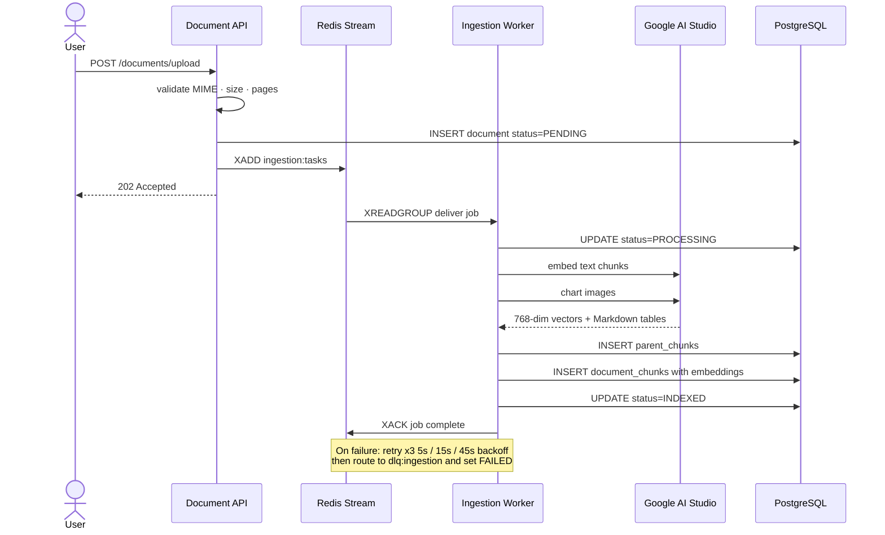
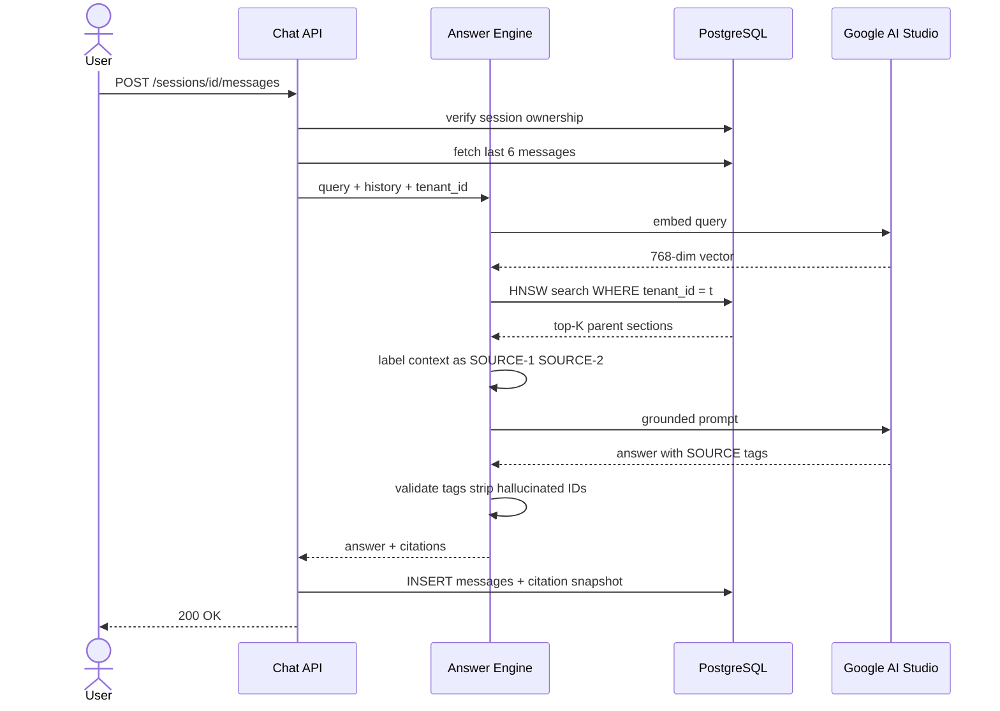
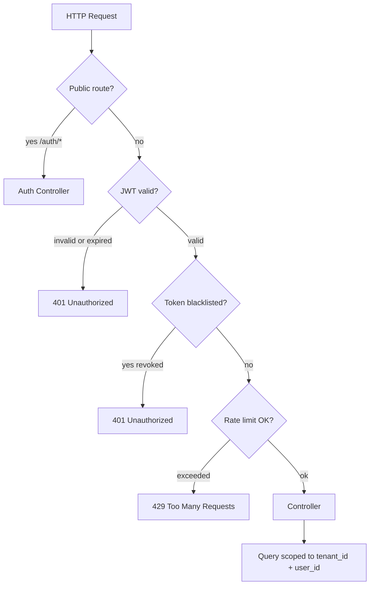
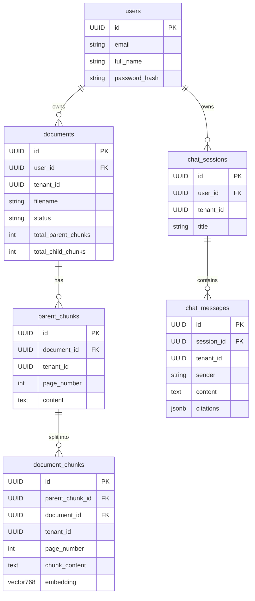

 # Project Master Specification: AI Knowledge Assistant

> **Project Name:** AI Knowledge Assistant
> **Version:** 2.0 (Revised & Updated)
> **Status:** 🟢 Active — All 4 core features **COMPLETED**
> **Architecture Pattern:** Spec-Driven, ADR-First, Dual-Service
> **Repository Root:** `C:/Users/nandi/Documents/projects/ai-knowledge-assistant`
> **Last Updated:** 2026-09-17

---

## Table of Contents

1. [Executive Summary](#1-executive-summary--vision)
2. [System Architecture](#2-system-architecture)
   - 2.1 [Component Overview](#21-component-overview)
   - 2.2 [Detailed Component Map](#22-detailed-component-map)
   - 2.3 [Document Ingestion Flow](#23-document-ingestion-flow)
   - 2.4 [Question-Answering (RAG) Flow](#24-question-answering-rag-flow)
   - 2.5 [Security & Authorization Flow](#25-security--authorization-flow)
   - 2.6 [Service Responsibility Boundaries](#26-service-responsibility-boundaries)
3. [Tech Stack](#3-tech-stack)
4. [Database Schema Overview](#4-database-schema-overview)
5. [API Endpoint Summary](#5-api-endpoint-summary)
6. [AI Model Selection](#6-ai-model-selection)
7. [Multi-Modal Ingestion Strategies](#7-multi-modal-ingestion-strategies)
8. [Security Model](#8-security-model)
9. [Deployment & Infrastructure](#9-deployment--infrastructure)
10. [Master Feature Registry](#10-master-feature-registry)
11. [Glossary](#11-glossary)

---

## 1. Executive Summary & Vision

The **AI Knowledge Assistant** is an enterprise-grade document intelligence system. Authenticated users upload proprietary documents (PDF, DOCX, TXT)—including complex **tables** and visual **charts/diagrams**—which are asynchronously parsed, chunked, and indexed into a high-performance vector store (PostgreSQL + `pgvector`).

Users ask questions in natural language and receive answers that are:
- ✅ **Strictly grounded** in the uploaded document content (no hallucinations)
- ✅ **Cited** with verifiable source references (document name + page number)
- ✅ **Tenant-isolated** — users can only see and query their own documents
- ✅ **Conversational** — multi-turn sessions with sliding-window context memory

> [!NOTE]
> The system operates entirely on **Google AI Studio's free tier** (Gemini 2.5 Flash + text-embedding-004), making it zero-cost to prototype and deploy.

---

## 2. System Architecture

### 2.1 System Overview

The system has two services — a **Spring Boot API** that handles all public traffic, and a **Python RAG Service** that does the heavy AI work. Both share the same data stores.



> **Reading guide:** Solid arrows = synchronous calls. Dashed arrow = async job delivery via Redis Stream. All database access is scoped to `(tenant_id, user_id)`.

---

### 2.2 Document Upload Path

What happens step-by-step when a user uploads a document.



---

### 2.3 Question-Answering Path

What happens step-by-step when a user asks a question.



---

### 2.4 Document Ingestion Sequence

Detailed timing of the async ingestion pipeline.



---

### 2.5 RAG Query Sequence

Detailed timing of the grounded question-answering pipeline.



---

### 2.6 Security Pipeline

Every request passes through this three-stage pipeline before reaching any controller.



> [!IMPORTANT]
> **Every** database query — documents, chunks, sessions, messages — is filtered by `(tenant_id, user_id)`. Cross-tenant access returns `404 Not Found` to prevent ID enumeration attacks.

---

### 2.7 Service Responsibility Boundaries

| Layer | Owns | Does NOT Own |
| :--- | :--- | :--- |
| **Spring Boot API** | Identity, JWT auth, rate limiting, document metadata, session/message CRUD, public REST contracts | Parsing, chunking, embeddings, vector search, prompt construction |
| **Python RAG Service** | Ingestion jobs, parsing, chunking, embedding, retrieval, grounding, citation validation | User authentication, authorization policy, session ownership |
| **PostgreSQL + pgvector** | Relational records, immutable message history, parent/child chunk storage, tenant-filtered vector search | Raw file storage, job delivery, model inference |
| **Redis** | Rate-limit counters, ingestion job delivery (`ingestion:tasks`), JWT revocation blacklist, short-lived cache | Durable document or conversation records |
| **Object Storage** | Original uploaded document files | Metadata, embeddings, or conversation records |
| **Google AI Studio** | 768-dim text embeddings, visual chart analysis, grounded answer generation | Data storage, authentication, routing |

---

## 3. Tech Stack

| Category | Technology | Version | Purpose |
| :--- | :--- | :--- | :--- |
| **Backend Gateway** | Spring Boot | 3.x | REST API, JWT security, rate limiting, session management |
| **Runtime** | Java | 21 (LTS) | Backend application runtime |
| **AI Service** | Python + FastAPI | 3.11+ | Ingestion worker, RAG engine, embedding, citation extraction |
| **Vector Database** | PostgreSQL + pgvector | 16 + 0.7+ | ACID metadata, vector storage, HNSW similarity search |
| **Job Queue / Cache** | Redis | 7+ | Async ingestion queue (Streams), rate limiting (Lua), JWT blacklist |
| **Document Parsing** | PyMuPDF (fitz) | Latest | PDF text and bounding-box extraction |
| **Table Extraction** | pdfplumber | Latest | Detect and serialize tables to Markdown |
| **MIME Validation** | Apache Tika | Latest | Magic-byte sniffing for upload security |
| **Embedding Model** | Google text-embedding-004 | — | 768-dimensional semantic vectors (free tier) |
| **Generation Model** | Google Gemini 2.5 Flash | — | RAG answer generation + multimodal vision (free tier) |
| **Containerization** | Docker + Docker Compose | Latest | Local dev environment |
| **Build Tool** | Maven | 3.x | Java dependency management |

---

## 4. Database Schema Overview

All tables carry `(tenant_id, user_id)` for strict multi-tenant isolation. `ON DELETE CASCADE` ensures clean lifecycle management.



### Key Database Indexes

| Index Name | Table | Columns | Type | Purpose |
| :--- | :--- | :--- | :--- | :--- |
| `idx_documents_tenant_owner` | `documents` | `(tenant_id, user_id)` | B-tree | Fast owner filtering |
| `idx_documents_status` | `documents` | `(status)` | B-tree | Queue worker polling |
| `idx_parent_chunks_tenant_owner` | `parent_chunks` | `(tenant_id, user_id)` | B-tree | Tenant-scoped expansion |
| `idx_chunks_tenant_owner` | `document_chunks` | `(tenant_id, user_id)` | B-tree | Pre-filter before vector scan |
| `idx_chunks_embedding_hnsw` | `document_chunks` | `(embedding vector_cosine_ops)` | **HNSW** | Fast approximate vector search |
| `idx_chat_sessions_tenant_user` | `chat_sessions` | `(tenant_id, user_id)` | B-tree | Session ownership filtering |
| `idx_chat_messages_session_id` | `chat_messages` | `(session_id)` | B-tree | Thread retrieval |

> [!TIP]
> The HNSW index is configured with `m=16, ef_construction=64` — tuned for accuracy/speed balance on CPU hardware.

---

## 5. API Endpoint Summary

All endpoints require `Authorization: Bearer <JWT_TOKEN>` unless marked **Public**.

### Auth Endpoints

| Method | Path | Description | Auth |
| :--- | :--- | :--- | :--- |
| `POST` | `/api/v1/auth/register` | Create a new user account | Public |
| `POST` | `/api/v1/auth/login` | Login and receive access + refresh tokens | Public |
| `POST` | `/api/v1/auth/refresh` | Exchange refresh token for new access token | Public |
| `POST` | `/api/v1/auth/logout` | Revoke current access token (Redis blacklist) | Required |

### Document Endpoints

| Method | Path | Description | Response |
| :--- | :--- | :--- | :--- |
| `POST` | `/api/v1/documents/upload` | Upload a document (PDF, DOCX, TXT; max 50MB, 100 pages) | `202 Accepted` |
| `GET` | `/api/v1/documents/{id}/status` | Poll document indexing status (owner only) | `200 OK` |
| `DELETE` | `/api/v1/documents/{id}` | Delete document + all chunks + raw file | `204 No Content` |

### Chat Endpoints

| Method | Path | Description | Response |
| :--- | :--- | :--- | :--- |
| `POST` | `/api/v1/chat/sessions` | Create a named chat session | `201 Created` |
| `GET` | `/api/v1/chat/sessions` | List all sessions for the authenticated user | `200 OK` |
| `GET` | `/api/v1/chat/sessions/{id}/messages` | Get the full message thread for a session | `200 OK` |
| `POST` | `/api/v1/chat/sessions/{id}/messages` | Ask a question (triggers RAG pipeline) | `200 OK` |
| `DELETE` | `/api/v1/chat/sessions/{id}` | Delete session + all messages | `204 No Content` |

### Internal Service Endpoint (Python → Spring calls this)

| Method | Path | Description |
| :--- | :--- | :--- |
| `POST` | `/rag/generate` | Generate grounded answer (called by Spring Boot Chat API) |

---

## 6. AI Model Selection

All models run on **Google AI Studio (Free Tier)** with OpenAI as a fallback.

| Capability | Primary Model | Fallback | Key Specs |
| :--- | :--- | :--- | :--- |
| **Text Embeddings** | `text-embedding-004` (Google) | `text-embedding-3-small` (OpenAI) | 768 dimensions · Free tier · HNSW-indexed |
| **Answer Generation** | `gemini-2.5-flash` (Google) | `gemini-2.5-pro` / `gpt-4o-mini` | 1M token context · ~300ms latency · 15 RPM free |
| **Visual Chart Analysis** | `gemini-2.5-flash` (Google) | `gpt-4o-mini` (OpenAI) | Converts chart images → Markdown tables + trend summaries |

> [!NOTE]
> **All embeddings must be strictly 768 dimensions.** Switching embedding models without re-indexing all document chunks will break vector search. See [ADR-06 in FEAT-001 design](../features/FEAT-001-document-ingestion/design.md).

---

## 7. Multi-Modal Ingestion Strategies

The system supports two pluggable ingestion strategies, controlled by the environment variable `INGESTION_STRATEGY`.

### Strategy A — Parent-Document (Small-to-Big) Pipeline ✅ Default

**Target:** Standard CPU servers, Google AI Studio free tier.

```
Document
    └── Parent Chunks (~1,000–1,500 tokens each)   ← stored in parent_chunks (no embedding)
            └── Child Chunks (~150–200 tokens each)  ← stored in document_chunks (768-dim embedding)
```

**How retrieval works:**
1. User query → embed with `text-embedding-004` → 768-dim query vector
2. Search `document_chunks` via HNSW cosine similarity (`<=>`)
3. Join back to `parent_chunks` using `DISTINCT ON (parent_chunk_id)`
4. LLM receives the full parent section (rich context, no fragmentation)

**Special handling:**
- **Tables:** Detected by `pdfplumber`, serialized to Markdown pipe tables. Headers re-injected if a table spans multiple chunks.
- **Charts/Figures:** Bounding boxes cropped by `fitz`, analyzed by Gemini vision, stored as descriptive Markdown chunks tagged `{"type": "chart"}`.

### Strategy B — Native Visual RAG via ColPali 🔬 Advanced (GPU required)

**Target:** GPU-enabled workers or HuggingFace VLM inference endpoints.

1. Each PDF page is rendered as a high-resolution image (150–300 DPI)
2. ColPali (PaliGemma-based) generates ~1,024 visual patch vectors per page
3. Queries are matched against patch vectors via **late interaction (MaxSim)**
4. Top matching full-page images are fed directly to Gemini 2.5 Flash for answer generation
5. Bypasses all text parsing and OCR entirely

| | Strategy A | Strategy B |
| :--- | :--- | :--- |
| **Hardware** | CPU | GPU required |
| **Cost** | Free (AI Studio) | Compute costs apply |
| **Parsing** | Text + table + chart extraction | Raw page images only |
| **Best for** | Text-heavy documents with tables | Visually complex documents, diagrams |
| **Enable via** | (default) | `INGESTION_STRATEGY=colpali` |

---

## 8. Security Model

### Authentication
- **Short-lived access tokens:** 15-minute JWT with claims `{sub, tenant_id, role, jti, exp, iat}`
- **Refresh token rotation:** 7-day refresh tokens stored hashed in DB; rotated on every use
- **Logout / Revocation:** `POST /auth/logout` writes `bl:token:<jti>` to Redis with TTL = remaining token lifetime

### Rate Limiting (Redis Lua Token Bucket)

| Endpoint Scope | Redis Key Pattern | Bucket Capacity | Refill Rate |
| :--- | :--- | :--- | :--- |
| Auth endpoints | `rl:auth:<client_ip>` | 10 tokens | 10 / minute |
| Document uploads | `rl:upload:<tenant_id>:<user_id>` | 5 tokens | 5 / hour |
| Chat queries | `rl:chat:<tenant_id>:<user_id>` | 30 tokens | 30 / minute |
| Read/Status APIs | `rl:read:<tenant_id>:<user_id>` | 120 tokens | 120 / minute |

Exceeded limits return **HTTP 429** with `X-RateLimit-Limit`, `X-RateLimit-Remaining`, and `Retry-After` headers.

### Authorization (Multi-Tenant Isolation)
- Every database query is filtered by `WHERE tenant_id = :t AND user_id = :u`
- Accessing another user's resource returns `404 Not Found` (prevents ID enumeration)
- Vector similarity search includes tenant filters **before** HNSW distance calculation

---

## 9. Deployment & Infrastructure

### Local Development (Docker Compose)

```text
docker/
├── docker-compose.yml        # Full local stack
└── init-db/
    └── 01-init-pgvector.sql  # Schema, extensions, and HNSW indexes
```

**Services started by `docker-compose.yml`:**
- `assistant_postgres` — PostgreSQL 16 with `pgvector` extension
- `assistant_redis` — Redis 7
- `assistant_backend` — Spring Boot API (port 8080)
- `assistant_ai_service` — Python FastAPI RAG service

### Project Directory Structure

```text
ai-knowledge-assistant/
├── AGENTS.md                           # Workspace rules for AI agent workflow
├── README.md                           # Project overview and architecture
├── .env.example                        # Environment variable template
├── docker/                             # Local dev infrastructure
│   ├── docker-compose.yml
│   └── init-db/01-init-pgvector.sql
├── specs/
│   └── main-spec.md                    # ← You are here
├── features/                           # Spec-driven feature modules
│   ├── README.md                       # Feature status dashboard
│   ├── FEAT-001-document-ingestion/
│   ├── FEAT-002-rag-query-citations/
│   ├── FEAT-003-auth-and-rate-limiting/
│   └── FEAT-004-chat-sessions-history/
├── backend/                            # Spring Boot Java API
│   ├── Dockerfile
│   ├── pom.xml
│   └── src/
└── ai-service/                         # Python FastAPI RAG service
    ├── Dockerfile
    ├── requirements.txt
    └── app/
```

### Key Environment Variables

| Variable | Description | Example |
| :--- | :--- | :--- |
| `GOOGLE_API_KEY` | Google AI Studio API key | `AIza...` |
| `DB_URL` | PostgreSQL JDBC URL | `jdbc:postgresql://localhost:5432/knowledge_assistant` |
| `REDIS_URL` | Redis connection URL | `redis://localhost:6379` |
| `JWT_SECRET` | HS256 signing secret (min 256-bit) | `your-secret-key` |
| `JWT_ACCESS_EXPIRY_MS` | Access token TTL | `900000` (15 min) |
| `JWT_REFRESH_EXPIRY_DAYS` | Refresh token TTL | `7` |
| `INGESTION_STRATEGY` | `default` or `colpali` | `default` |
| `STORAGE_PATH` | Local file storage path | `/shared/storage` |
| `MAX_FILE_SIZE_MB` | Upload size limit | `50` |

---

## 10. Master Feature Registry

All features follow the **Spec-Driven & ADR-First Lifecycle** in the [`features/`](../features/) directory.

| Feature ID | Feature Name | Status | Key Design Decisions | Links |
| :--- | :--- | :--- | :--- | :--- |
| **`FEAT-001`** | Document Ingestion Pipeline | ✅ `COMPLETED` | Async Redis Streams queue · Parent-Child chunking · Gemini 768d embeddings · Multimodal chart vision · Multi-tenant scoping · DLQ + retry resilience | [Spec](../features/FEAT-001-document-ingestion/spec.md) · [Design](../features/FEAT-001-document-ingestion/design.md) · [Tasks](../features/FEAT-001-document-ingestion/tasks.md) · [Testing](../features/FEAT-001-document-ingestion/testing.md) |
| **`FEAT-002`** | Grounded RAG Query & Citations | ✅ `COMPLETED` | Opaque `[SOURCE-X]` server-assigned citations · HNSW cosine retrieval · Zero-hallucination grounding prompt · Tenant-isolated vector search | [Spec](../features/FEAT-002-rag-query-citations/spec.md) · [Design](../features/FEAT-002-rag-query-citations/design.md) · [Tasks](../features/FEAT-002-rag-query-citations/tasks.md) · [Testing](../features/FEAT-002-rag-query-citations/testing.md) |
| **`FEAT-003`** | JWT Auth & Redis Rate Limiting | ✅ `COMPLETED` | 15-min access tokens · 7-day refresh rotation · Redis blacklist revocation · Atomic Lua token bucket rate limiting | [Spec](../features/FEAT-003-auth-and-rate-limiting/spec.md) · [Design](../features/FEAT-003-auth-and-rate-limiting/design.md) · [Tasks](../features/FEAT-003-auth-and-rate-limiting/tasks.md) · [Testing](../features/FEAT-003-auth-and-rate-limiting/testing.md) |
| **`FEAT-004`** | Chat Sessions & Conversation History | ✅ `COMPLETED` | Strict session ownership · Sliding window context (<6 turns / 3,000 tokens) · Immutable JSONB citation snapshots · Cascading deletion | [Spec](../features/FEAT-004-chat-sessions-history/spec.md) · [Design](../features/FEAT-004-chat-sessions-history/design.md) · [Tasks](../features/FEAT-004-chat-sessions-history/tasks.md) · [Testing](../features/FEAT-004-chat-sessions-history/testing.md) |

### ADR Master Index

| ADR | Feature | Title | Status |
| :--- | :--- | :--- | :--- |
| FEAT-001 ADR-01 | Document Ingestion | Async Task Dispatch vs. Synchronous Ingestion | ✅ ACCEPTED |
| FEAT-001 ADR-02 | Document Ingestion | PostgreSQL + pgvector HNSW vs. Dedicated Vector DB | ✅ ACCEPTED |
| FEAT-001 ADR-03 | Document Ingestion | Page-Preserving Recursive Text Chunking | ✅ ACCEPTED |
| FEAT-001 ADR-04 | Document Ingestion | Table Extraction (pdfplumber) + Markdown Header Preservation | ✅ ACCEPTED |
| FEAT-001 ADR-05 | Document Ingestion | Multimodal Vision Processing for Charts & Diagrams | ✅ ACCEPTED |
| FEAT-001 ADR-06 | Document Ingestion | Unified Free-Tier Model Selection (Google AI Studio) | ✅ ACCEPTED |
| FEAT-001 ADR-07 | Document Ingestion | Pluggable Strategy A (Markdown) vs. Strategy B (ColPali) | ✅ ACCEPTED |
| FEAT-001 ADR-08 | Document Ingestion | Parent-Document (Small-to-Big) Chunking Architecture | ✅ ACCEPTED |
| FEAT-001 ADR-09 | Document Ingestion | Multi-Tenant & Owner Authorization Scoping | ✅ ACCEPTED |
| FEAT-001 ADR-10 | Document Ingestion | Resilient Worker (Redis Streams, Retries, DLQ, Idempotency) | ✅ ACCEPTED |
| FEAT-001 ADR-11 | Document Ingestion | Ingestion Safety, Limits & Lifecycle Cleanup | ✅ ACCEPTED |
| FEAT-002 ADR-01 | RAG Query | Opaque `[SOURCE-X]` Citations + Server-Side Metadata Resolution | ✅ ACCEPTED |
| FEAT-002 ADR-02 | RAG Query | Cosine Distance (`<=>`) with 768d HNSW Embeddings | ✅ ACCEPTED |
| FEAT-002 ADR-03 | RAG Query | Zero-Hallucination Grounding Prompt Strategy | ✅ ACCEPTED |
| FEAT-002 ADR-04 | RAG Query | Tenant & Owner Authorization in Vector Search | ✅ ACCEPTED |
| FEAT-003 ADR-01 | Auth & Rate Limiting | JWT Access Token Lifecycle, Refresh Rotation & Revocation | ✅ ACCEPTED |
| FEAT-003 ADR-02 | Auth & Rate Limiting | Distributed Redis Lua Token Bucket (Defined Profiles) | ✅ ACCEPTED |
| FEAT-003 ADR-03 | Auth & Rate Limiting | Explicit Per-User and Tenant Authorization Framework | ✅ ACCEPTED |
| FEAT-004 ADR-01 | Chat Sessions | Strict Session Ownership & Tenant Scoping | ✅ ACCEPTED |
| FEAT-004 ADR-02 | Chat Sessions | Sliding Window Context Truncation (<6 turns / 3,000 tokens) | ✅ ACCEPTED |
| FEAT-004 ADR-03 | Chat Sessions | Message Schema & Immutable Citation Snapshot (JSONB) | ✅ ACCEPTED |
| FEAT-004 ADR-04 | Chat Sessions | Retention & Cascading Deletion Policy (90 days) | ✅ ACCEPTED |

---

## 11. Glossary

| Term | Definition |
| :--- | :--- |
| **RAG** | Retrieval-Augmented Generation — a technique that retrieves relevant documents before generating an LLM answer, grounding the response in verified source material |
| **pgvector** | A PostgreSQL extension that adds a `vector` data type and similarity search operators, enabling the database to store and query embedding vectors |
| **HNSW** | Hierarchical Navigable Small World — a graph-based algorithm for fast approximate nearest-neighbor search in high-dimensional spaces |
| **Embedding** | A numerical vector representation of text that captures its semantic meaning; similar texts have vectors that are close together in vector space |
| **Parent Chunk** | A large text segment (~1,000–1,500 tokens) stored without an embedding, used to provide rich context to the LLM when a related child chunk is retrieved |
| **Child Chunk** | A small text segment (~150–200 tokens) with a 768-dim embedding vector, used as the unit of vector similarity search |
| **`[SOURCE-X]`** | A server-assigned opaque citation tag given to retrieved chunks before sending to the LLM; prevents the model from hallucinating filenames or page numbers |
| **Tenant** | An organizational account (identified by `tenant_id`); all data is strictly isolated between tenants |
| **ColPali** | A visual RAG model (PaliGemma-based) that generates patch-level embeddings of document page images, enabling retrieval without text extraction |
| **ADR** | Architecture Decision Record — a document capturing the context, options considered, decision made, and trade-offs for a significant technical choice |
| **DLQ** | Dead-Letter Queue — a Redis stream (`dlq:ingestion`) where failed ingestion tasks land after exhausting all retries |
| **Sliding Window** | A context management strategy that caps conversation history sent to the LLM to the last 6 turns or 3,000 tokens, whichever is smaller |
| **MIME sniffing** | Reading a file's binary magic bytes to determine its true type, independent of the user-supplied filename extension (security measure against disguised malicious files) |
| **Cosine Distance** | A similarity metric (`<=>` operator in pgvector) that measures the angle between two vectors — smaller angle = more semantically similar |
